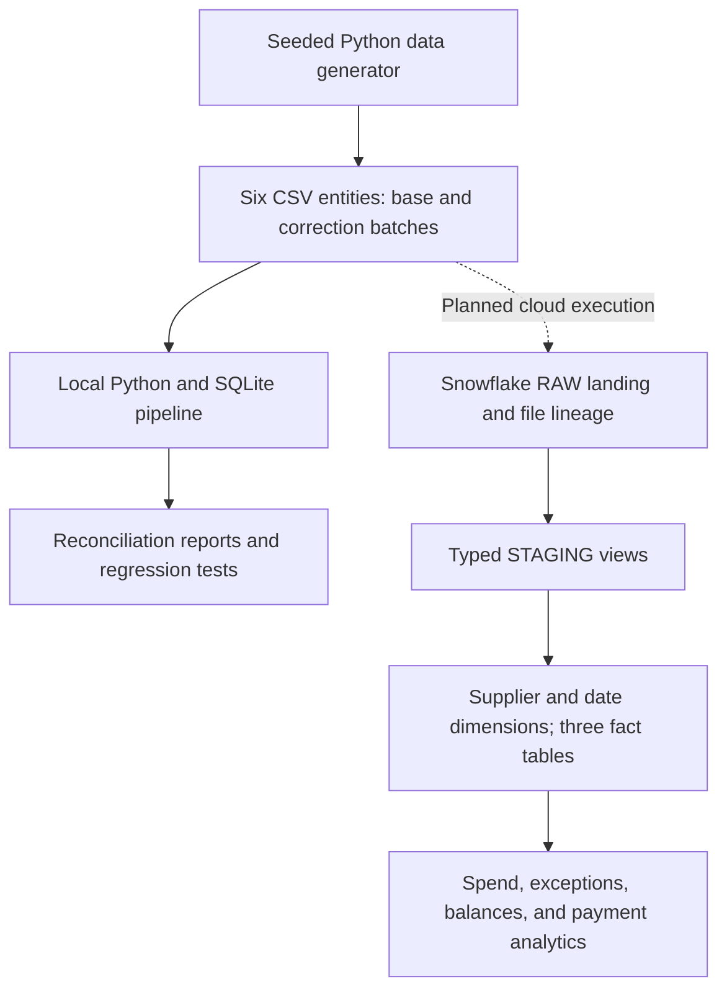

# Purchase-to-Pay Analytics

## From raw transactions to reconciled spend

A procurement analytics project built with **Python and SQL** to answer a simple question: can the numbers in a spend report be traced back to the underlying transactions?

The project generates fictional purchase orders, invoices, and payments; models them at their correct grains; flags invoice exceptions; and reconciles source records to analytical outputs. It includes an executable **Python/SQLite local implementation** and a **Snowflake SQL implementation awaiting cloud execution**.

**Verified locally:** 12 regression tests and 227 reconciliation checks passed. Identical batch replays leave analytical counts and amounts unchanged. See the [validation results](docs/validation-status.md) and [portable evidence snapshot](docs/evidence/local-validation.json).

All records are synthetic. No real company, supplier, or customer data is used.

## Business problem

Purchase orders show what a company agreed to buy, invoices show what suppliers charged, and payments show what was paid. Treating these records as interchangeable can inflate spend, hide unpaid balances, and produce inconsistent reports.

This project answers:

- How much has been invoiced, and how concentrated is spending among suppliers?
- Which suppliers have the highest invoice-exception rates?
- How much spending has no valid purchase-order reference?
- Which invoices remain overdue, and what balance is unpaid?
- Which invoices were paid early, late, partially, or above the invoiced amount?

## Example results

Observed in the corrected synthetic dataset, with reporting fixed at **March 31, 2025**:

| Metric | Result |
| --- | ---: |
| Invoiced spend | $197,978.95 |
| Top-five supplier share of spend | 32.13% |
| Spend without a PO reference | $21,616.96 |
| Spend with an invalid PO reference | $70.00 |
| Overdue invoices with positive balances | 53 |
| Total overdue positive balance | $56,824.80 |

These are demonstration outputs, not findings about a real company or claims of business savings. Definitions, reconciliation totals, and sample-size caveats are in the [validation report](docs/validation-status.md).

## Architecture



The Snowflake SQL is supplied, but its cloud execution has not been verified. The local implementation exercises business rules; it does not emulate Snowflake COPY, MERGE syntax, permissions, performance, or billing.

See the [dimensional model](docs/model.md) for the detailed diagram, keys, and SQL pattern.

## Key design decisions

### Keep transaction grains separate

| Fact | One row represents |
| --- | --- |
| Purchasing | One purchase-order line |
| Invoicing | One invoice line |
| Payment | One payment allocation to an invoice |

An invoice with two lines and three payments produces six rows if the detail tables are joined directly. Summing that join repeats both invoice and payment amounts. This project independently aggregates each side to invoice level before comparing them. `SUM(DISTINCT amount)` is not used as a workaround.

### Make corrections auditable

- Raw local audit rows append on every load attempt; latest-source records and facts remain deduplicated.
- Newer source timestamps control updates; equal-timestamp conflicting payloads are rejected.
- Corrections update existing records rather than append duplicate facts.
- Effective-dated supplier history assigns each fact to the supplier version valid on its event date.
- Late supplier versions can restate historical fact attribution without changing transaction amounts.

### Define amounts and exceptions explicitly

- Spend is invoice-line quantity multiplied by unit price, calculated in integer USD cents.
- PO commitments, invoiced spend, and payments remain separate measures.
- Header discrepancies are flagged, not overwritten to force agreement.
- Missing PO references and invalid PO references remain visible as separate exceptions.
- Exception rates count invoices, not lines or overlapping flags.
- Historical balances exclude payments after the reporting date; negative overpayment balances remain visible.

The [data contract](docs/data-contract.md) defines source fields, timestamp rules, and analytical semantics.

## Run locally

### Requirements

- Python 3.11 or newer, including the standard-library `sqlite3` module.
- No third-party Python packages, Snowflake account, dbt, or paid service is required for the local path.

From the repository root:

```bash
python scripts/generate_data.py --output data --seed 42
python scripts/validate_local.py --data data --output artifacts/run-1
python -m unittest discover -s tests -v
```

On Windows, substitute `py -3` for `python` if needed.

The generator creates six base CSVs, six correction CSVs, and `data/expected.json`. The validator processes the base batch, repeats it, applies corrections, and repeats the corrections. It writes:

```text
artifacts/run-1/
├── local.sqlite
├── reconciliation.json
└── reconciliation.md
```

Open `reconciliation.md` for the readable report. A successful validator command prints `"passed": true`; the regression suite prints `OK`.

**For another validation run, use a fresh output directory**, such as `artifacts/run-2`. The validator refuses to overwrite an existing database so previous evidence is preserved. Generated data, databases, and full local reports are excluded from Git; they are recreated by the commands above.

**The generator does overwrite existing files at its `--output` path.** For a different seed or dataset, choose a new data directory, for example `--output data/seed-43 --seed 43`, and pass that directory to the validator's `--data` argument. Do not regenerate source files during a load/replay sequence or change files already uploaded to Snowflake. Replays reuse the existing batch files.

## Validation

The recorded seed-42 run contains 25 suppliers, 26 supplier versions, 123 PO headers, 370 PO lines, 138 invoices, 391 invoice lines, and 120 payment allocations.

| Check | Observed result |
| --- | --- |
| Regression tests | 12 passed; no failures or errors |
| Source, target, fixture, and replay checks | 227 passed |
| Same seed generated twice | All 13 generated files byte-identical |
| Different seed | Generated output changed |
| Base / base replay applied rows | 1,168 / 0 |
| Corrections / correction replay applied rows | 4 / 0 |
| Latest source versus fact counts and cents | Exact matches |
| SQLite integrity check | Passed |

Coverage includes multi-line/multi-payment joins, future-payment exclusion, partial and excess payments, due-date boundaries, overlapping exceptions, atomic rejection of invalid batches, stale corrections, supplier-history restatement, and zero-value invoices.

The checked-in [evidence snapshot](docs/evidence/local-validation.json) omits private paths, credentials, and database files. It records local results only, not a live CI status. The [validation report](docs/validation-status.md) also documents the development runner's post-execution access warning.

## Run on Snowflake

Follow the [ordered deployment runbook](sql/snowflake/README.md), not a blind execution of all numbered files.

- Initial deployment: `00` through `09`.
- Optional administrator role provisioning: `11`.
- Corrections and replay: `10` → `04` → `06` → `09`.
- Deliberate performance and cost measurement: `12`.

A Snowflake account, authorized sandbox roles, and a compatible client for local file uploads are required. Cloud resources can consume credits. Keep connection credentials outside the repository.

**Not yet verified:** live Snowflake SQL compilation, COPY/MERGE behavior, role isolation, Query Profile, and credit usage. No cloud performance, cost savings, or production-readiness result is claimed. Use the [cloud evidence checklist](docs/snowflake-evidence.md) when an account is available.

## Repository guide

```text
.
├── README.md
├── .gitignore
├── .gitattributes
├── scripts/
│   ├── generate_data.py
│   └── validate_local.py
├── sql/
│   ├── local/001_marts.sql
│   └── snowflake/                 # 13 ordered SQL scripts and deployment README
├── tests/test_validate_local.py
└── docs/
    ├── data-contract.md
    ├── model.md
    ├── validation-status.md
    ├── snowflake-evidence.md
    ├── publishing.md
    └── evidence/local-validation.json
```

## Scope and limitations

This is a portfolio-scale reference implementation. It uses one currency, a fixed 2025 reporting calendar, synthetic data, and upsert-only corrections. Tax, FX, credit notes, receipts/three-way matching, reversals, source deletes, and bitemporal audit reconstruction are out of scope. Full-source refreshes favor transparency over high-volume CDC optimization.

A dashboard, dbt project, scheduler, CI workflow, and measured cloud benchmark are not included.

## Publishing and reuse

See the [publishing checklist](docs/publishing.md) for a clean source-only export, suggested repository description/topics, and publication steps. No software license has been selected; add your chosen license before granting reuse rights. No license or employment affiliation is implied.

## Sources

- [Snowflake COPY INTO table](https://docs.snowflake.com/en/sql-reference/sql/copy-into-table)
- [Snowflake MERGE](https://docs.snowflake.com/en/sql-reference/sql/merge)
- [Snowflake Query History and Query Profile](https://docs.snowflake.com/en/user-guide/ui-snowsight-activity)

## License

Project code and documentation are offered under the [MIT License](LICENSE), copyright 2026 Ghospool. Python, SQLite, Snowflake, and other third-party dependencies and services retain their own licenses and are not redistributed as installed environments or application binaries.

All generated procurement records are fictional. No employer, supplier, customer, or other proprietary business data is included.

## Publishing and reuse

See the [publishing checklist](docs/publishing.md) for a clean source-only export, suggested repository description/topics, and publication steps.

This repository is a portfolio-scale reference implementation. The local Python/SQLite pipeline has been verified as documented, while the Snowflake implementation remains unverified in a live cloud environment. Reuse of the code does not imply production readiness, verified cloud compatibility, or employment affiliation.
