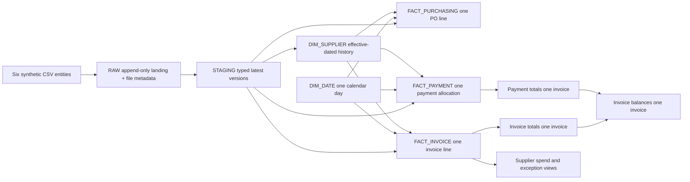

# Dimensional model

## Data flow



## Grains and keys

| Object | Exactly one row per | Business key | Important relationship |
| --- | --- | --- | --- |
| Raw suppliers | Landed supplier-version record | Not unique in raw | File metadata preserves lineage |
| Raw PO headers | Landed PO header record | Not unique in raw | Parent of PO lines |
| Raw PO lines | Landed PO line record | Not unique in raw | References PO header |
| Raw invoice headers | Landed invoice header record | Not unique in raw | Parent of invoice lines |
| Raw invoice lines | Landed invoice line record | Not unique in raw | Optional PO-line reference |
| Raw payments | Landed invoice-payment allocation | Not unique in raw | References invoice header |
| Staging suppliers | Latest supplier effective-date version | supplier_id, effective_from | Not just supplier_id |
| Other staging entities | Latest natural-key source record | Respective source ID | Timestamp-controlled deduplication |
| DIM_SUPPLIER | Supplier effective-date interval | supplier_id, valid_from | Half-open date range |
| DIM_DATE | Calendar day in 2025 | date_key | Role-playing date dimension |
| FACT_PURCHASING | PO line | po_line_id | Many lines to one PO |
| FACT_INVOICE | Invoice line | invoice_line_id | Many lines to one invoice |
| FACT_PAYMENT | Payment allocation to an invoice | payment_id | Many allocations to one invoice |
| Invoice balance view | Invoice | invoice_id | Joins independently aggregated facts |

Supplier surrogate keys are deterministic strings, for example `SUP001|2025-01-01`. The date surrogate is an integer `YYYYMMDD`. Facts resolve supplier history using their own business event date, not whichever supplier version is current at load time. Late supplier versions restate relevant fact keys while retaining transaction amounts. This is effective-dated SCD2, not a bitemporal record of what the warehouse knew at every historical instant.

## Why a direct join is wrong

An invoice with two lines worth $100 and $200 and three allocations worth $50, $75, and $100 produces six rows when lines and allocations are joined on invoice_id. Summing that join gives $900 invoiced and $450 paid, rather than the correct $300 invoiced and $225 paid.

The balance model groups each side to one row per invoice first, then joins those results. Supplier spend reads only invoice facts. Exception rates collapse line flags to one invoice-level boolean before counting invoices. `SUM(DISTINCT amount)` is not a valid repair: unrelated transactions can have identical amounts.

The core SQL pattern is:

```sql
WITH invoice_totals AS (
    SELECT invoice_id, SUM(invoiced_amount_cents) AS invoiced_cents
    FROM MART.FACT_INVOICE
    WHERE invoice_date <= '2025-03-31'::DATE
    GROUP BY invoice_id
), payment_totals AS (
    SELECT invoice_id, SUM(amount_cents) AS paid_cents
    FROM MART.FACT_PAYMENT
    WHERE payment_date <= '2025-03-31'::DATE
    GROUP BY invoice_id
)
SELECT i.invoice_id, i.invoiced_cents, COALESCE(p.paid_cents, 0) AS paid_cents,
       i.invoiced_cents - COALESCE(p.paid_cents, 0) AS balance_cents
FROM invoice_totals i
LEFT JOIN payment_totals p ON p.invoice_id = i.invoice_id;
```

Here `COALESCE` models the legitimate absence of payments as zero; it does not hide missing invoice parents or malformed amounts, which fail ingestion checks.

The relationship between purchasing and invoicing is not one-to-one either. Several invoice lines can reference the same PO line. PO commitments must come from FACT_PURCHASING, not from summing PO amounts repeated on invoice lines. No mart combines purchasing, invoicing, and payment amounts into a single additive spend measure.

## Business boundaries

- Spend is quantity × invoice unit price, in integer USD cents; headers are reconciled separately.
- No purchase-order reference and an invalid purchase-order reference are distinct exceptions.
- A supplier mismatch is an exception even when its PO-line reference exists.
- Overdue excludes invoices due on the reporting date and future-dated payment allocations.
- Credit notes, tax, FX, receipts/three-way matching, reversals, payment-to-many-invoice banking structures, and source deletes are outside this demonstration.
- Stock Snowflake primary/foreign-key declarations are not a substitute for the supplied uniqueness, relationship, and reconciliation checks.

See [the data contract](data-contract.md) for exact columns and exception definitions.
